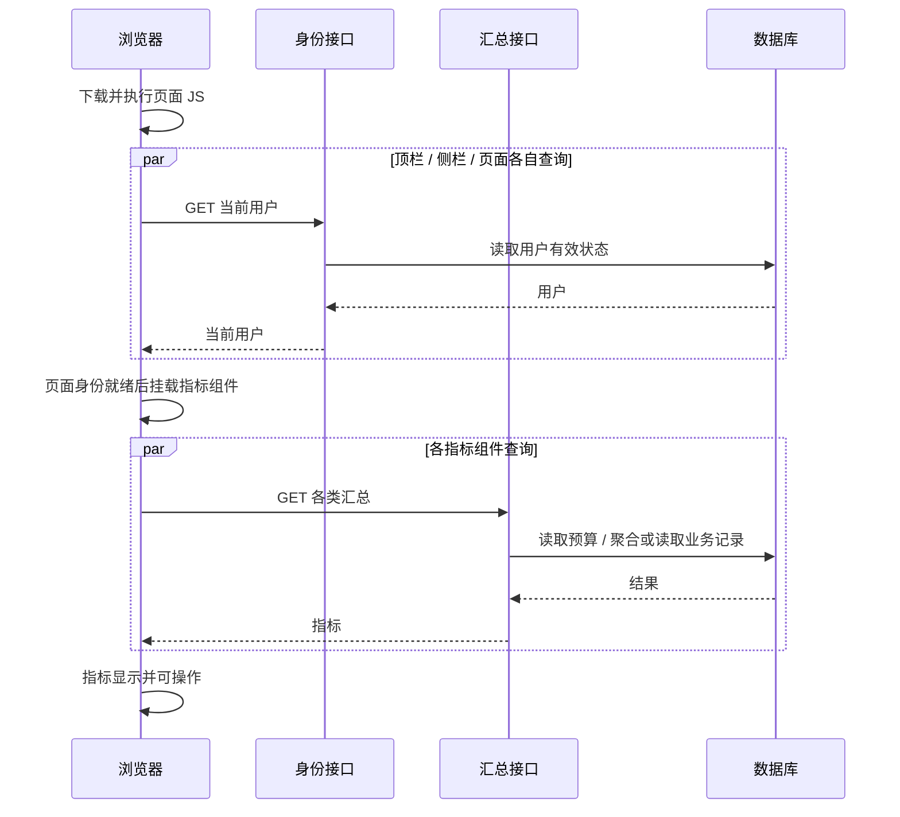

# 性能优化分析与决策记录

日期：2026-10-16（Asia/Shanghai）  
代码基准：`7ac7921`，`package.json` 版本 `0.21.0`。  
状态：已由用户确认定稿（2026-10-16）；本次确认范围为分析结论，应用实施尚未开始。

## 已达成的范围

- 覆盖工作台、项目列表/概览、执行台账、业务记录浏览/筛选/录入、统计、导入、导出和附件。
- 先做可测量、改动较小的优化，再按证据决定是否调整架构。
- 用户已接受第一版端到端 p95 目标：日常切换/筛选 ≤1秒、首次主要页面可用 ≤2秒、单条记录保存确认 ≤1秒；取得可比基线后再校准。
- 用户已接受按任务规模区分体验：小任务即时完成，证实重任务干扰日常操作后可采用进度与后台执行；导入仍保持整批成功或整批失败。
- 主验收容量为 10 个项目、每项目 1 万条业务记录、10 名活跃用户；更大规模作为压力探索。
- 重任务运行时，日常操作仍遵守原体验目标；可限制重任务并发或让其排队，不默认放宽日常延迟。
- 以内网桌面浏览器为主验收环境，弱网络作为探索项。
- 本轮只产生分析文档，未修改应用、数据库、部署或版本号；未对运行中的服务发起请求或压测。
- 沿用领域约束：执行台账是实时视图；停用、角色变更和凭证撤销即时生效；财务写入仍保留查重、审计、授权和既有事务语义。

## 结论与证据边界

最明确的机会是减少不必要的数据搬运和重复工作：附件列表读取二进制、项目业务记录全量取数与渲染、只为科目选择计算完整台账、筛选输入放大查询、部分汇总把业务明细搬到 Node 后再计算。它们有代码证据，但实际收益取决于数据量、网络、并发和设备。

尚无证据支持直接引入 Redis、读写分离、全面改成 Server Components 或更换技术栈。应先测端到端关键动作，再选择这些成本较高的方案。

证据分三种：**代码事实**说明当前行为；**现场观察**只描述现有环境；**性能假设**必须通过对照测量验证。本文的优先级是调查与实施候选顺序，不等于生产耗时排名，也不承诺改善百分比。

## 已确认的整体方案

用户已确认以下顺序：先固定生产构建下的可复现基线，再消除确定的浪费，然后处理随数据量增长的查询和渲染成本。后台任务、共享缓存、对象存储和预计算仅在证据满足准入条件后另行设计，不作为首批工作的默认前提。

| 阶段        | 主要交付                                                                                  | 进入下一阶段的依据                                                                 |
| ----------- | ----------------------------------------------------------------------------------------- | ---------------------------------------------------------------------------------- |
| A：基线     | 10 个项目 × 每项目 1 万条记录、10 个活跃会话；主要路径端到端分段计时；正常/重任务混合负载 | 能复现并区分网络、查询、连接等待、计算、渲染的主要成本；样本量、环境和错误率可审阅 |
| B：小改     | 附件元数据投影、轻量科目读取、筛选请求合并、无用科目扫描消除、明确错误/刷新状态           | 结果与权限不变，目标操作的请求/取数/渲染开销可观察地减少，无交互回退               |
| C：规模成本 | 项目业务记录服务端分页及全集合计/候选/导出；台账与统计聚合；共享身份与项目元数据          | 金额与筛选范围等价，主验收档按已确认目标评估，混合负载下检查日常体验               |
| D：重任务   | 导出提前限额与专用读取、导入批量往返、预览选项复用；必要时限制并发/排队                   | 先测是否足以保护日常目标，再决定是否需要持久化后台任务及独立执行进程               |

这里的顺序允许基线证据调整同一阶段内部优先级；若某项已达到目标且不影响其他路径，不为追求更低数字而扩大改造。所有阶段保留即时撤权、实时台账、重复防护、逐条审计和原子入账。

首阶段交付以基线与可独立验证的小改为界，分页/聚合可作为后续独立变更。整个分析的范围仍覆盖全部主要路径，不能将“先小改”理解为忽略统计、导入和导出。用户已在 Q8 确认这一整体理解，分析结论定稿；应用实施不在本次确认范围内。

## 现有环境与观测

- 生产 Docker 配置使用 production 与 standalone；本机 3000 端口对应本仓库的 `next dev`。不能把本机开发态体验当作生产基线，也不能推断线上误用了开发模式。
- 现有 `.next/standalone/package.json` 为 `0.20.1`，构建时间为 2026-10-15 15:47:30；当前代码是 `0.21.0`。旧产物只能提供线索，不能代表当前构建。
- API 统一包装器已有 `requestId / method / path / status / durationMs`，见 [withRoute.ts](../../src/lib/api/withRoute.ts#L153)。它覆盖 handler 内部耗时，无法解释全部页面编译、下载、浏览器渲染或用户交互时间；当前成功响应也未统一携带 requestId。
- Prisma 连接池配置基线为 10，交互事务超时基线 30 秒，大批量事务为 120 秒。实际部署可以覆盖连接上限。应测连接等待、事务占用和吞吐，不能单凭超时就增大连接池。
- CI 有类型、lint 和单测，无浏览器性能与混合负载基线。已有 ExcelJS 动态加载、Office 预览隔离、部分 SQL 聚合和列表分页，应保留。

对现成开发日志做了只读聚合：2026-10-15 19:15:14 至 2026-10-16 13:29:26，共 261 个 `http_request`，仅输出路由级统计，不包含业务内容、参数或身份。

| GET 路由                        | 样本数 | p50 / p95 / max，毫秒 |
| ------------------------------- | -----: | --------------------: |
| `/api/me`                       |     46 |           5 / 22 / 27 |
| `/api/projects`                 |     32 |          10 / 35 / 43 |
| `/api/statistics/custom-facets` |     32 |          12 / 35 / 38 |
| `/api/statistics/cross-project` |     24 |          17 / 77 / 87 |
| `/api/me/projects`              |     24 |          11 / 30 / 41 |
| `/api/statistics/custom`        |     23 |          30 / 60 / 77 |
| `/api/approvals/pending`        |     20 |           9 / 29 / 33 |
| `/api/statistics/risk-summary`  |     12 |          16 / 44 / 44 |

这些是零散、无控制负载的开发态样本；部分样本数很小，p95 不稳定。它们不覆盖项目记录列表、导入或导出，也不证明端到端体验已经达标。当前不能据此断言“API 普遍慢”。

旧构建 client-reference manifest 引用的 JS 逐文件 gzip 估算约为：首页 106.6 KiB、统一录入 193.7 KiB、项目记录 197.3 KiB。此数包含部分共享布局，未包含全部运行时和动态资源，也不是浏览器实际首屏下载量。Office 的大 chunk 已动态隔离，不能当作首页必载资源论证。

## 主要等待链路

首页现状时序见 [Mermaid 源文件](./dashboard-waterfall.mmd) 与 [SVG](./dashboard-waterfall.svg)。身份、指标查询均在客户端 effect 发起；身份完成前指标组件不挂载。因此即使 API 各自很快，首次访问仍串联了 JS 就绪、身份往返和业务数据往返。

这不是网络 trace；它表达代码中的依赖关系。是否还有重复请求合并、额外 RSC 请求、编译或主线程长任务，需浏览器测量。

## 改进候选

### 1. 附件列表只取元数据（优先，范围小）

**事实**：[recordAttachment.service.ts:76](../../src/server/services/recordAttachment.service.ts#L76) 查询用了 `include`，未限定主模型字段，随后 `toMeta()` 才丢弃 `data`；模型的 `data` 是 Bytes。上传 create 的返回也取出完整主模型后丢弃内容。

**影响假设**：只是打开文件名列表，也会先把这条记录的全部附件二进制从数据库搬到应用；文件越大，网络、内存与对象处理成本越高。这里不表示二进制已发送给浏览器。

**方向**：显式选择列表需要的字段与上传人；下载保留取二进制的独立路径。无需先迁移对象存储。测试固定元数据、不同合成文件大小，比较 DB 返回字节、RSS 与 API p95，保留记录归属/权限测试。

### 2. 选择科目使用轻量接口（优先，范围小）

**事实**：[项目记录页:346](<../../src/app/(dashboard)/projects/[id]/records/page.tsx#L346>) 获取完整 `/ledger` 后，只提取叶科目的 ID、代码和名称；项目详情还与 [ProjectShell:42](../../src/components/layout/project-shell.tsx#L42) 重复获取。元数据未齐时整页骨架阻塞，见项目记录页 1112 行。

**方向**：复用已有科目接口；项目布局共享元数据；列表结果与表单选项分别就绪。度量少掉的 SQL、请求字节及首批记录可用时间。共享 UI 数据不能替代 API 写入时重新授权。

### 3. 统一录入筛选控制请求频率（优先，范围小至中）

**事实**：[data-table-filter.tsx:269](../../src/components/ui/data-table-filter.tsx#L269) 文本/金额每次输入即更新筛选；[统一录入页:470](<../../src/app/(dashboard)/records/page.tsx#L470>) 随之请求统计接口；[URL 状态 hook:108](../../src/lib/table/use-url-table-state.ts#L108) 同步 `router.replace`。请求序号只防旧响应覆盖新结果，没有取消旧 HTTP 请求。

**方向**：文本/数字输入保留即时本地反馈，对提交查询做短防抖；离散选择即时生效；新查询取消过期 fetch，合并 URL 回写，保留现有序号保护。取消浏览器请求不保证数据库查询随之取消，减小发起次数才是主要减负手段。额外 RSC 往返应先用网络面板确认。

**验证**：固定连续输入十个字符，记录请求数、SQL 次数与总耗时、最后输入到结果稳定时间。防抖值先作为可调参数，不预先承诺某个毫秒值最优。

### 4. 项目业务记录改为服务端分页（优先，范围中）

**事实**：[项目记录页:371](<../../src/app/(dashboard)/projects/[id]/records/page.tsx#L371>) 全量拉取含作废记录；1042 行在客户端筛选/排序/faceting，1066 行逐次渲染累加金额，1313 行渲染所有结果。保存/修改后仍重拉全集。API 已支持可选分页（[route.ts:73](../../src/app/api/projects/[id]/records/route.ts#L73)），UI 没有启用。

**方向**：复用统一录入已有的服务端筛选、排序、分页能力；列表与筛选全集合计、筛选候选、导出范围分开。只在浏览器截取当前页不足以减少取数；先分页，仍存在大量可见行卡顿时再决定虚拟化。

**必须保持**：合计覆盖筛选全集；候选不因翻页缺失；导出覆盖既定筛选范围；批量作废不扩大选择范围。当前项目 API 不能直接表达全部 UI 列筛选，不能只添加 `page/pageSize` 就视为完成。按金额、日期、创建时间等排序时应有唯一 ID 作为最终排序键；深页游标是后续候选，需要考虑跳页与多列排序体验。

**验证**：100、1,000、10,000 行下的响应体、DOM 数、长任务和交互 p95；验证翻页前后合计一致、筛选/导出语义一致。

### 5. 台账、跨项目统计和录入预警下推聚合（优先，范围中）

**事实**：[ledger.service.ts:77](../../src/server/services/ledger.service.ts#L77)、275 行和 [statistics.service.ts:599](../../src/server/services/statistics.service.ts#L599) 读取业务明细后按科目/项目分组计算金额，且没限制只取计算字段。[businessRecord.service.ts:209](../../src/server/services/businessRecord.service.ts#L209) 年度超预算预警同样读明细求和。余额、月度、风险统计已有 SQL 聚合，不能把所有统计都判定为全量实现。

**方向**：用项目/科目/状态分组求和，数据库扫描仍可能随有效记录数增长，但返回应用的行数缩至聚合桶数；减少对象构造、Decimal 转换和 GC。先复用现有预算计算语义，不建立需要额外维护的汇总表。

**必须保持**：Decimal 精度、有效/作废区分、PAID 与应付未付、年度与总口径、一般项目与包干制分母。容量护栏使用了遗留结转排除逻辑，不能为统一 helper 而悄悄改变台账已有语义。

**验证**：1,000 / 10,000 / 100,000 条合成记录；新旧结果逐项对照，比较查询行数/字节、SQL 时间、RSS 和端到端 p95。这里的十万是压力档位，不是声称当前已有该数据量。

### 6. 统一查询减少无用扫描和重复聚合（优先，范围中）

**事实**：[statistics.service.ts:219](../../src/server/services/statistics.service.ts#L219) 即使不检索科目也读取科目树；多项目条件下该读取未按多项目范围收窄。393、411、427、450 行依次执行明细、状态汇总、count/有效合计、预算读取。独立步骤之间有串行等待，并重复计算有效金额。

**方向**：有科目检索才读对应树；预算使用求和；复用有效金额/计数结果；在连接资源允许时并行独立读取。衡量整次操作 SQL 次数与吞吐，不能用更多 `Promise.all` 代替容量分析。

**正确性注意**：列表与合计必须是同一筛选全集；保留空集哨兵、作废显示与凭证项目范围。预算 summary 当前没有全面采用所有多值筛选条件，这需要单独确认口径，不能混入性能修改。列表与汇总在并发写入时的一致性也应沿用现行契约，若要求同一快照另作设计。

### 7. 首页共享身份与更轻的汇总（次优先，范围小至中）

**事实**：[首页:87](<../../src/app/(dashboard)/page.tsx#L87>) 先取身份，104–135 行身份就绪后才挂载指标组件；顶栏与侧栏也分别取 `/api/me`。首页项目数请求完整跨项目金额结果，年度卡片又取另一口径的汇总。

**方向**：先共享身份与请求中的 Promise，减少重复请求；项目数使用轻量来源；允许独立区域分别就绪。SSO 下可评估服务端启动首批数据并传入客户端，但 mock 身份存于 localStorage，不能直接假定两种认证模式可用同一服务端取数策略。无需为此改造所有页面。

**必须保持**：年度预算与总预算口径不同，两个结果不能简单合并；身份状态以每次服务端校验为准，不使用跨用户全局缓存。共享 UI 身份应有明确刷新时机，不把旧权限当授权依据。

### 8. 导出使用专用通路，先控制读取上限（次优先，范围中）

**事实**：[统一录入页:920](<../../src/app/(dashboard)/records/page.tsx#L920>) 每页 500 条串行拉取，最多 200 页，每页重复调用会计算合计的 `/statistics/custom`，最后在浏览器生成完整 XLSX。[export.service.ts:183](../../src/server/services/export.service.ts#L183) 的已有服务端导出也是全量取数后才检查行数上限；不能直接切换过去就认为内存问题已解决。

**方向**：先共享权限与筛选构造规则，提早检查行数或有界读取 `cap + 1`；专用导出只取需要列，避免每页重复聚合；再依据大小选择游标分批、流式文件或后台任务。并发写入时导出边界要明确，不能因 offset 翻页漏行/重复行。超过上限应明确反馈，不能静默导出前若干行。

**验证**：500 / 5,000 / 50,000 行的请求数、SQL 次数、完成时间、浏览器堆/服务端 RSS；导出时并行浏览/保存的 p95 和错误率。小导出不能为架构整齐而增加排队等待。

### 9. 导入预览减少重复构造与全表重渲染（次优先，范围小至中）

**事实**：[settlement-import-preview.tsx:177](../../src/components/records/settlement-import-preview.tsx#L177) 为每行重建科目选项，688 行渲染全部可导入行；215 行修改一条记录会映射两组全集。多项目场景有“行数 × 科目数”的重复选项构造。

**方向**：按目标项目预构造选项；稳定行 props 和回调、行级记忆化；量大再分页或虚拟化。现有乐观暂存与串行 patch 队列已经在解决乱序问题，应保留，不直接无界并发。

**验证**：200 / 1,000 / 2,000 行，单项目与多项目映射，测首屏和改科目交互、渲染次数、DOM 与暂存队列等待。

### 10. 导入确认减少逐行数据库往返（次优先，范围中至大）

**事实**：[excelImport.service.ts:662](../../src/server/services/excelImport.service.ts#L662)、[settlementImport.service.ts:1843](../../src/server/services/settlementImport.service.ts#L1843) 逐行新增和写审计；补全更新还有逐行读取、更新、历史和审计。批量事务上限为 120 秒，不代表一次导入实际一定耗时 120 秒。

**方向**：事务外准备非竞争性计算和待写数据；事务内批量新增记录与逐行对应审计，补全更新单独处理；尽量缩短占连接时间。交互事务内的同一连接不能靠 `Promise.all` 获得数据库并行执行。

**必须保持**：原子批次状态占用、确认时重验、各目标项目授权、单据部分唯一索引、补全更新金额一致与状态只前进、逐条审计。不能简单拆成可部分提交的多个事务，不能使用跳过重复来静默改变导入结果。后台执行若采用，也不自动改变原子性。

**验证**：200 / 1,000 / 2,000 行与不同新增/补全更新比例，记录事务耗时、SQL 数、池等待和并行日常操作 p95。

### 11. 附件上传/打包与日常请求隔离（后续按证据，范围中至大）

**事实**：[项目记录页:527](<../../src/app/(dashboard)/projects/[id]/records/page.tsx#L527>) 保存后逐附件上传，再重拉全量记录，直到 551 行才恢复 submitting。附件 ZIP 在取齐二进制后生成完整 buffer；已有总数/字节上限，默认总字节 512 MiB，但每请求上限并不等于进程全局并发预算。

**方向**：区分“记录已保存”与“附件上传中”，有限并发并支持失败重试；主列表先应用已确认返回的数据。附件打包先限流/排队和内存预算，测量证实必要后再引入后台任务或对象存储。记录成功、附件部分失败的状态必须清楚展示，避免用户重试导致重复记录。

### 12. 错误与刷新状态清晰化（可与小改同时进行）

**事实**：[AuthWidget.tsx:31](../../src/components/auth/AuthWidget.tsx#L31) 请求失败后一直保留骨架；统一录入项目列表获取失败也可能保留 `projects=null` 的加载态。用户容易将失败误认为“还在慢慢加载”。

**方向**：明确 pending / success / error / retry；首次加载和后台刷新分开，已有结果刷新时保留，并清楚标示状态。写操作只在服务端确认后显示成功，刷新不能覆盖用户正在填写的内容。不要无限自动重试财务写入。

## 索引、缓存与更大架构变更的准入条件

现有记录、历史、到账、附件和审计索引已经覆盖部分路径。候选包括记录的过滤+稳定排序组合、全局年度有效记录、导入批次的创建人/项目与时间组合、成员关系按用户反查，以及审计常用组合过滤。只有实际慢查询及执行计划支持时才加；比较扫描行、排序/临时文件、缓存命中、写入成本和索引体积。

当前 SSO 身份实时查库是产品约束。API Key 每次更新 `lastUsedAt` 可作为后续节流候选，但“最近使用”的精度变化需要明确决定。跨请求缓存角色、停用或撤销状态会改变即时生效语义，不能作为默认优化。可以先减少请求本身与请求内部重复读取。

以下升级均是候选，尚未决定：

| 候选               | 需要的证据                                    | 需要先解决的设计问题                            |
| ------------------ | --------------------------------------------- | ----------------------------------------------- |
| 后台导入/导出/打包 | 重任务造成交互 p95、池等待或 RSS 明显恶化     | 幂等、重试、进度、结果保留、授权复验、原子入账  |
| 共享缓存           | 去掉浪费并优化 SQL 后，同一纯读取仍是主要成本 | 更新与失效完整性、用户/凭证范围隔离、允许新鲜度 |
| 预计算汇总         | 实时聚合在目标数据量下仍超预算                | 写入维护成本、修复/对账、所有变更入口一致性     |
| 附件对象存储       | 二进制下载/打包成为 DB 网络或内存主要负担     | 迁移、一致性、备份、权限与生命周期              |
| 读副本/多实例      | 有明确 DB/应用资源瓶颈和规模需求              | 复制延迟、实时撤权、多实例任务/缓存协调         |
| 大范围服务端渲染   | 页面 JS/水合/客户端瀑布仍主导可用时间         | 两种认证模式、交互边界、错误与加载策略          |

这些是有后续维护代价的取舍，达到准入条件且用户确认后才考虑 ADR。普通投影、分页、防抖和 SQL 重写无需为了留痕新增 ADR。

## 分阶段验证与交付建议

### 已确认的验收目标与待定测量条件

| 操作                       | 第一版端到端 p95 目标 | 状态                     |
| -------------------------- | --------------------- | ------------------------ |
| 日常页面切换 / 记录筛选    | ≤1秒                  | 用户已确认，测基线后校准 |
| 首次进入主要页面至数据可用 | ≤2秒                  | 用户已确认，测基线后校准 |
| 单条记录提交至保存确认     | ≤1秒                  | 用户已确认，测基线后校准 |

上述目标衡量用户操作到结果可用的全过程，不以 API 平均耗时代替。附件上传时间与记录保存确认分别记录，不能把未完成的附件显示成已上传成功；首批结果可见、表单恢复可操作和列表刷新完成也应分别计时，最终核对时明确各指标终点。

容量已确定为 10 个项目、每项目 1 万条记录、10 名活跃用户，以内网桌面浏览器为主；更大规模与弱网络另作压力探索。10 名活跃用户应建模为独立会话的浏览、筛选与少量写入，而不是简单等同于 10 个同时发出的 HTTP 请求；具体行为比例、停顿和数据分布随可复现基线记录，避免使用无法解释的吞吐数字。

重任务运行时日常操作仍遵守同一目标。混合测试需记录任务类别、文件字节、行数和并行数量，分别测试代表性大小与现有上限；首次验证可先让一个重任务运行，检查日常体验，再逐步提高任务并发以寻找需要排队的边界。不能在尚未记录机器、数据库和网络条件时声称正式验收通过。

任务即时/后台处理的行数或字节阈值不预先指定：先根据可测的耗时、内存和干扰确定，阈值改变不应改变授权、查重或原子入账语义。前台及时反馈与后台任务完成时间分别度量，避免用“已排队”代替“导入已成功”。

### 阶段 A：建立可比较的端到端基线

固定当前生产构建、合成数据库、机器资源和数据库网络位置；运行时使用符合现有启动守卫的 SSO/测试身份，不能禁用生产守卫来方便测量。优先建立隔离环境，不覆盖现有开发产物或操作生产财务数据。

覆盖全部路径，但每条单独看指标，不能把大量轻请求和少量慢操作混成一个平均值：

| 路径                   | 测量终点                           | 关键分段                                     |
| ---------------------- | ---------------------------------- | -------------------------------------------- |
| 首页 / 项目列表 / 概览 | 主要数据可见且可点击               | TTFB、JS、身份、业务请求、渲染               |
| 执行台账 / 统计        | 金额与筛选结果稳定                 | 认证、SQL/等待、聚合、序列化、渲染           |
| 业务记录筛选 / 翻页    | 最后一次操作对应结果稳定           | 发起次数、网络、SQL、JSON、DOM/长任务        |
| 单笔保存               | 服务端确认记录保存                 | 查重、预算预警、事务、附件、列表刷新分别计时 |
| 导入                   | 上传/解析/预览/暂存/确认各阶段完成 | CPU、SQL 次数、事务占用、队列与失败状态      |
| 导出 / 附件            | 首次反馈、文件可取、完成           | 取数、生成、内存、传输及其他用户受影响情况   |

记录 p50/p95、样本量、错误率、响应字节、SQL 次数/时间、连接等待、事件循环延迟、RSS 与浏览器长任务。Web Vitals 辅助解释首次访问；客户端导航和保存仍需显式业务计时。成功响应关联 requestId，必要时提供 Server-Timing 分段，日志避免写入财务正文或凭证。

主验收使用 10 个项目 × 每项目 1 万条业务记录，10 名活跃用户；1千行和单用户场景帮助定位固定成本，更大规模帮助观察增长趋势。导入测试采用 200/1千/2千行，并覆盖不同附件大小与导出范围，明确正常和重任务混合场景。区分冷启动/首次访问/重复导航；预热后重复采样，报告测量环境和分位计算方法。没有足够样本不下稳定 p95 结论。

### 阶段 B：小范围消除浪费

建议首批候选：附件元数据投影、科目轻量读取、筛选请求合并、错误/刷新状态、无必要科目扫描。每项单独对照，保留回退路径，不打包成难以归因的大改。

### 阶段 C：改善随数据量增长的成本

项目记录服务端分页与完整合计/候选/导出语义；台账/跨项目/录入预警聚合下推；统一查询减少重复聚合；首页身份/元数据共享。先确认结果等价，再对照各数据档位和混合负载，只有新瓶颈出现才拓宽测试范围。

### 阶段 D：重任务处理

先修导出提前限额与重复统计、导入批量往返、预览重复选项。若仍影响交互，依据已确认的 Q4/Q6 策略采用限并发、排队或进度任务，并以保护日常目标为优先。跨请求缓存、对象存储、预计算、读副本暂不进入默认实施清单。

## 设计树与访谈记录

- Q1，范围：**全部主要路径一起评估**（用户已确认）。
- Q2，改动幅度：**先小改，再按证据升级**（用户已确认）。
- Q3，体验验收：**采用建议目标，测基线后校准**（用户已确认）。端到端 p95 日常切换/筛选 ≤1秒、首次主要页面可用 ≤2秒、单条保存确认 ≤1秒。这是第一版验收目标，不是已证明能达标的承诺。
- Q4，大任务体验：**接受按任务规模区分**（用户已确认）。小任务即时完成；证实重任务影响交互后可采用进度与后台执行，保持整批语义。这不是立即引入任务队列的决定。
- Q5，容量目标：**采用建议的主验收档**（用户已确认）。10 个项目、每项目 1 万条业务记录、10 名活跃用户；更大规模作为压力探索，不为其提前增加架构复杂度。
- Q6，重任务干扰边界：**日常操作守目标，重任务可排队**（用户已确认）。优先限重任务并发或排队，不默认放宽日常操作目标；测量证明成本过高时才重新讨论标准。
- Q7，主要体验环境：**内网桌面为主，弱网络另测**（用户已确认）。这定义验收范围，不是对当前所有用户访问环境的调查结论。
- Q8，整体方案核对：**认可，按此定稿分析**（用户已于 2026-10-16 确认）。认可“基线 → 小改 → 规模成本 → 按证据处理重任务”的顺序、验收范围与现有业务约束；此次确认不代表开始修改应用代码。
- 已有约束不重复询问：实时台账、即时撤权、完整审计、查重和原子入账。
- 当前决策前沿为空：本次分析与设计访谈结束，无待用户回答的问题。
- 计时终点、负载行为、资源规格等测量条件在基线中明确记录；结果可用、附件完成和入账成功分别定义，不以排队/骨架冒充完成。
- Q4 与混合负载明确后：只有实际达到后台任务准入条件，才讨论完成通知/结果留存、重试和授权复验；若不需要则不展开该分支。
- 若缓存/预计算达到准入条件：再讨论可接受新鲜度与失效策略，不提前假定允许陈旧金额。
- 只在后续证据触发缓存/后台任务等候选时重新展开对应分支，不要求用户提前决定尚无必要的架构细节。分析已定稿，实施需另行明确任务范围。

`CONTEXT.md` 继续只收领域词汇。p95、缓存和加载状态是通用工程概念，故未写入领域词汇表；当前也未形成需新 ADR 记录的架构取舍。

## 文档核对

Next.js 通过 Context7 检索到最接近当前依赖的 `v16.2.9` 官方文档（项目为 16.2.12），用于核对布局提前取数、浏览器指标和大包分析思路；不直接假定新缓存指令已在本项目启用。

- [Next.js：SPA 与布局提前取数](https://github.com/vercel/next.js/blob/v16.2.9/docs/01-app/02-guides/single-page-applications.mdx)
- [Next.js：浏览器指标](https://github.com/vercel/next.js/blob/v16.2.9/docs/01-app/02-guides/analytics.mdx)

Prisma 的 Context7 结果混有更新客户端语法，因此另核对官方保留版文档与本地 5.22 生成类型/既有调用。本文建议只涉及项目已支持的 `select`、`groupBy` 和批量写入，不建议照搬新客户端 API。[字段选择](https://www.prisma.io/docs/orm/v6/prisma-client/queries/select-fields)说明 include 仍会返回主模型标量；[事务文档](https://www.prisma.io/docs/orm/v6/prisma-client/queries/transactions)说明长事务与同连接执行限制；[分组聚合文档](https://www.prisma.io/docs/orm/v6/prisma-client/queries/aggregation-grouping-summarizing)支持聚合下推的实现方向。具体收益仍以本项目测量为准。
